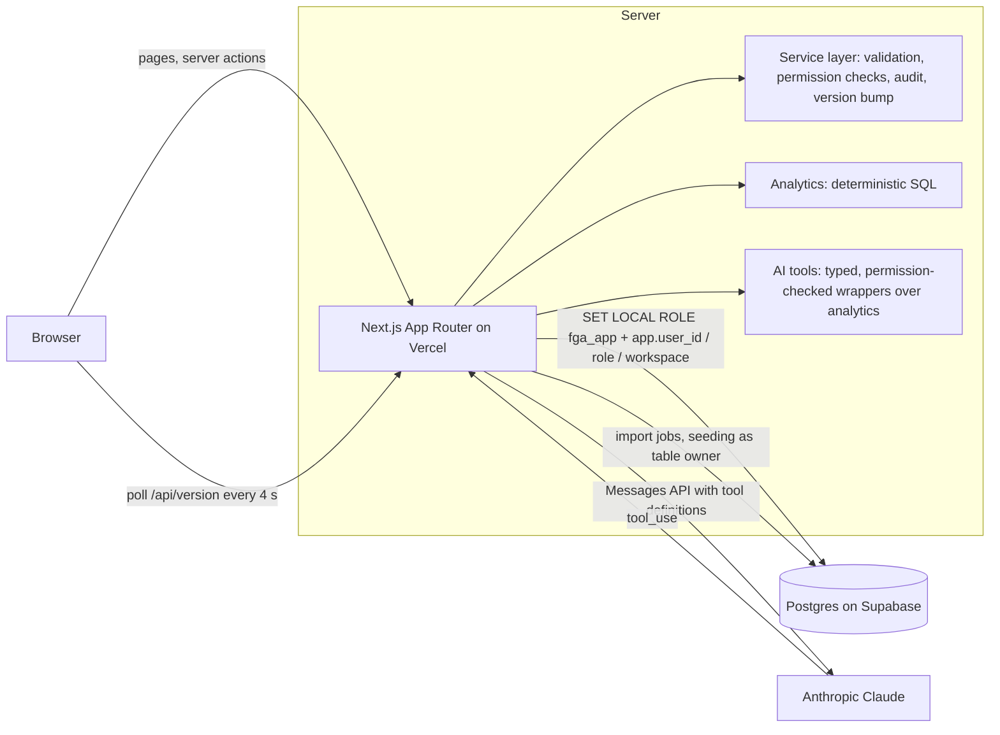
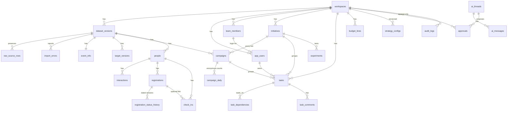

# Fest Growth Analytics

An operations and decision tool for a college fest team whose goal is to grow **unique, verified physical attendance**. It tracks the attendee funnel and campaigns, manages initiatives, tasks and budgets, and includes an AI Growth Analyst that answers from the current data and proposes changes that a person must approve.

The fest itself is not named anywhere in the app. The supplied historical dataset is a fictional event called "CampusFest 2025"; that name appears only where the app shows what is in the dataset.

## Contents

1. [What it does](#what-it-does)
2. [Run it locally](#run-it-locally)
3. [Demo accounts](#demo-accounts)
4. [Architecture](#architecture)
5. [Data model](#data-model)
6. [Roles and permissions](#roles-and-permissions)
7. [How metrics are defined](#how-metrics-are-defined)
8. [The AI Growth Analyst](#the-ai-growth-analyst)
9. [Importing a different dataset](#importing-a-different-dataset)
10. [Testing](#testing)
11. [Deployment](#deployment)
12. [Decisions, assumptions and limitations](#decisions-assumptions-and-limitations)

More detail lives in `docs/`: [deployment](docs/deployment.md), [data profile](docs/data-profile.md), [data dictionary](docs/data-dictionary.md), [metric definitions](docs/metric-definitions.md), [AI evaluation](docs/ai-evaluation.md).

## What it does

| Area | What you can do |
|---|---|
| Overview | Headline metrics from the active dataset, alerts (capacity unconfirmed, overdue tasks, critical campaigns, pending approvals), weekly trend, funnel, campaign health, and a separate panel for the upcoming fest's planning targets. An as-of date picker replays any day in the dataset. |
| Campaigns | Spend, registrations, confirmed, verified attendees, show-up rate, cost per registration and per verified attendee, opt-outs and a portfolio-relative health flag. Edit owner, status, budget, KPI targets, UTM code and notes. |
| Initiatives | The five growth bets with plan targets and budgets (labelled as assumptions), historical proxy evidence, tasks, experiments and the scale/change/stop rule. |
| Audience & Registrations | Record-level registrations and check-ins with pseudonymous IDs (no attendee names), daily visits, exclusion counts, and status or verification corrections with a required reason. |
| Funnel & Attribution | Identified → engaged → registered → confirmed → attended with labelled denominators; anonymous platform activity kept separate; three attribution views; targets vs actuals; period comparison. |
| Team | Roles, initiative assignments, owned campaigns and workload (open, overdue, blocked, remaining effort). |
| Tasks & Calendar | One set of tasks as a list, a Kanban board and a month calendar. Owners, reviewers, priorities, dates, effort, dependencies with cycle checks, comments and per-task activity history. |
| Budget | Base and stretch plans kept apart; approved, committed, spent and remaining never mixed; sponsor-funded lines excluded from festival totals; historical spend vs approved budget. Managers propose changes; admins approve. |
| Experiments | Hypothesis, segment, treatment and control, dates, metrics, a decision rule written before results, recorded results with uplift and an approximate 95% interval. |
| AI Growth Analyst | Chat that calls typed analytics tools, tags figures as observed, calculated or estimated, abstains when data is missing, and drafts tasks or changes into the approval queue. A side panel runs the same tools directly without the model. |
| Approvals | Before/after view of every proposal; approve (optionally editing owner and deadline) or reject. Approval applies the change and writes an audit record. |
| Strategy & Targets | Versioned planning assumptions: baseline, base and stretch targets, TAM/SAM, budget ceilings, planning show-up rate, thresholds and venue capacity (unconfirmed until an admin enters it). |
| Dataset Manager | Upload .xlsx or .csv, map sheets and columns with suggestions, validate, import as a new version, switch the active version, restore the demo state. |
| Audit log | Append-only record of every change, proposal and decision. |

Every dashboard reads from Postgres on each request. When anything changes, the workspace data version goes up and open pages refresh themselves within about four seconds.

## Run it locally

Requirements: Node 22+, Postgres 15+ (local or Supabase), Python 3 with pandas (only for the profiling script).

```bash
npm install
cp .env.example .env.local        # set DATABASE_URL and SESSION_SECRET
npm run db:migrate                # creates tables, the fga_app role and RLS policies
npm run db:seed                   # imports data/attendee-dataset.xlsx and demo records
npm run dev                       # http://localhost:3000
```

`npm run db:reset-demo` rebuilds the demo workspace from scratch. It keeps the audit log, which is append-only.

To turn on the AI analyst, set `ANTHROPIC_API_KEY` in `.env.local`. Without it the analyst page says the AI is unavailable and offers the tool panel instead.

## Demo accounts

All people are synthetic. The owners Meera Iyer, Arjun Verma, Nisha Rao and Dev Malhotra come from the supplied workbook's owner IDs (T03–T06).

| Role | Email | Password | Scope |
|---|---|---|---|
| Admin | admin@demo.fest | Demo-Admin-2026 | Everything: datasets, strategy, budgets, approvals, audit log |
| Campaign Manager | meera@demo.fest | Demo-Manager-2026 | Campus Cup and Campus Network; campaigns she owns |
| Campaign Manager | arjun@demo.fest | Demo-Manager-2026 | CrewPass, Challenge Circuit, Student Passport; campaigns he owns |
| Team Member | nisha@demo.fest | Demo-Member-2026 | Own tasks, comments, asking the AI |
| Team Member | dev@demo.fest | Demo-Member-2026 | Own tasks, comments, asking the AI |

The sign-in page does not list these accounts unless `SHOW_DEMO_LOGINS=true`. Change the passwords before using the app with real data.

## Architecture



- **Next.js 16 App Router + TypeScript**, server components for every page, server actions for forms, route handlers for the AI and imports.
- **Postgres** holds everything. Each user request runs in a transaction that switches to the restricted `fga_app` role and sets the user's ID, role and workspace. Row-level security policies then decide what each statement may read or write. System jobs (migrations, seeding, imports after an admin check) run as the table owner.
- **Live updates**: every mutation increments `workspaces.data_version`. A small client component polls `/api/version` and calls `router.refresh()` when it changes, so cards, tables and charts re-render from the database.
- **AI**: server-side tool use with the Anthropic SDK. The model never sees SQL or the database; it calls named tools that run the same analytics functions as the dashboards, inside the user's RLS scope.

## Data model



Imported facts carry both `workspace_id` and `dataset_version_id`, so versions never mix and switching the active version changes every query. The raw rows of every sheet are kept in `raw_source_rows` as JSON, and the original file bytes in `dataset_uploads`. Full column list: `supabase/migrations/0001_schema.sql`; mapping from the workbook: [docs/data-dictionary.md](docs/data-dictionary.md).

## Roles and permissions

Enforced twice: in the service layer (clear error messages) and by Postgres RLS (so a bug in the app cannot bypass it). Tests check both, including a direct SQL write attempt as a team member.

| Action | Admin | Campaign Manager | Team Member |
|---|---|---|---|
| View dashboards, campaigns, tasks | Yes | Yes | Yes |
| Ask the AI | Yes | Yes | Yes (same data scope as the user) |
| Create tasks | Yes | Yes, in their initiatives or unscoped | No |
| Edit tasks | Any | Their initiatives' tasks, tasks they own or created | Status and progress of their own tasks |
| Edit campaigns | Any | Campaigns they own or in their initiatives (not approved budget) | No |
| Budget lines | Edit | Propose a change for approval | No |
| Approve proposals | Yes (budget: not their own request) | Tasks and campaigns within their scope | No |
| Correct registration status | Yes | Their campaigns' registrations | No |
| Correct check-in verification | Yes | No | No |
| Strategy & Targets, datasets, audit log | Yes | No | No |

The AI cannot approve anything. Approval happens only through the authenticated UI.

## How metrics are defined

The rules come from the supplied workbook's own "Read me" and "Field guide" sheets. Summary (full list in [docs/metric-definitions.md](docs/metric-definitions.md)):

- **Unique verified attendees (north star)**: distinct people with at least one check-in where result = admitted and verification = verified, person type = external, up to the end of the as-of date. Someone who came on both days counts once. Daily visits are reported separately.
- **Duplicates**: exact repeated source IDs are import copies and count once (20 check-ins, 4 status rows, 2 daily marketing rows in the supplied file). A repeated ID with different values is rejected and listed.
- **Registration status**: the latest status version per registration effective on or before the as-of date.
- **Show-up rate** = registered external people with a verified admission ÷ registered external people.
- **Cost per verified attendee** = net spend ÷ verified attendees attributed by registration source. Descriptive, not causal.
- **Anonymous activity** (impressions, summed daily reach, clicks, sessions, form starts) is shown apart from the person funnel because those are event counts that cannot be joined to people.
- **Campaign health** is relative to the portfolio: critical if show-up is more than 15 points below the portfolio or cost per verified attendee is more than twice the median.

Reference values for the supplied file, produced independently by `scripts/profile-attendee-workbook.py` and checked by the tests: 2,050 unique verified external attendees (725 on both days, 125 without a registration), 2,800 registered external people, 3,625 identified external people, ₹2,74,000 net spend.

## The AI Growth Analyst

**How it answers.** For each question the server sends the conversation text and a list of 22 tools to Claude. The model chooses tools; the server validates each input with zod, runs it in the user's RLS-scoped transaction, and returns compact JSON. Only the text of earlier turns goes back to the model, never earlier tool results, so every follow-up re-queries current data. There are at most 8 rounds of tool calls per question.

**Tools**: `get_dataset_profile`, `get_data_quality_report`, `get_overview_metrics`, `get_attendance_metrics`, `get_funnel_metrics`, `get_campaign_performance`, `compare_campaigns`, `get_attribution`, `get_trends`, `compare_date_ranges`, `get_initiative_performance`, `get_budget_summary`, `get_task_metrics`, `get_overdue_tasks`, `get_team_workload`, `list_team_members`, `compare_experiment_cohorts`, `forecast_attendance`, `get_capacity_status`, `get_strategy_assumptions`, and two write-proposal tools, `draft_task` and `submit_change_for_approval`. Definitions: `src/lib/ai/tools.ts`.

**Answer format**: Answer, Evidence (each line tagged [Observed], [Calculated] with numerator and denominator, or [Estimated] with its assumption), Diagnosis, Recommendation, Uncertainty, Next step. The UI colours the tags and shows an expandable trace of every tool call and its result.

**Abstention.** The system prompt tells the model to say it cannot answer when a field is missing, the question is outside the data, a causal claim is requested from descriptive attribution, a forecast lacks history, capacity is unconfirmed, or a tool returns a permission error. The tools make this concrete: they return "Not present in selected dataset", `configured: false` for capacity, or `status: insufficient` with a reason for forecasts.

**Safety.** Tool results are framed as data, and the prompt says instructions inside records must be ignored. No tool returns attendee names or contact details. The AI can only create pending proposals; a person approves, edits or rejects them.

**When the key is missing**, the chat says so plainly and the tool panel still works.

## Importing a different dataset

Dataset Manager → Import a dataset (admin only):

1. Upload .xlsx or .csv. The file is stored unchanged and every sheet is profiled (types, empty rate, distinct values, preview).
2. Each sheet gets a suggested entity (event, targets, campaigns, daily campaign metrics, people, interactions, registrations, status history, check-ins, or ignore) and each column a suggested field, based on sheet names and header synonyms. You can change any of them. Required fields are marked, and the wizard says which analytics will be unavailable for anything left unmapped.
3. Import creates a new dataset version. The report shows rows read, imported, duplicates removed and rejected (with reasons), plus warnings such as "No person type mapped: every person is treated as an external visitor".

Analytics adapt to what was mapped: a dataset without status history shows "No status history in selected dataset" for the confirmed stage instead of inventing one, and the AI's `get_dataset_profile` tool reports the same gaps. The test upload in this repo (`Signups` and `Gate Scans` sheets with headers like "Attendee ID" and "Scan Time") maps automatically.

## Testing

| Suite | Command | What it covers | Last result |
|---|---|---|---|
| Unit + integration | `npm test` (needs `TEST_DATABASE_URL`, a disposable database) | Import counts and dedup, north star, as-of snapshots, funnel, per-campaign metrics, attribution sums, targets, trends, budgets, capacity, forecast abstention, RBAC through RLS, approval workflow, audit immutability, live data changes, AI tool outputs (including no attendee names) and the agent loop with a scripted model | 31/31 passed |
| Browser end-to-end | `npm run test:e2e` (needs a running server, Chrome and Playwright) | Login, task creation, status change, approving an AI draft with edits, campaign edit, live refresh of an open page, team-member restrictions | 8/8 checks passed |
| AI evaluation | `npm run eval:ai` (needs `ANTHROPIC_API_KEY`) | 25 questions with automatic checks, including abstention, changed data, follow-ups, approval and prompt injection | **Not yet run**: no API key in the build environment. See [docs/ai-evaluation.md](docs/ai-evaluation.md). |

## Deployment

**Quickest way (no database setup).** Upload the project to Vercel and add one environment variable, `ANTHROPIC_API_KEY`. With no `DATABASE_URL`, the app runs an embedded Postgres (PGlite) inside the server, started from the pre-seeded snapshot in `data/fga-db.tar.gz`. Row-level security, roles, approvals and the AI analyst all work the same way. The trade-off is that edits last only while a server instance is running: after a cold start, or on a different instance, the demo data comes back. That suits a demo or review. Rebuild the snapshot after changing the seed or migrations with `npm run db:snapshot`.

**Permanent data (Supabase).** Set `DATABASE_URL` to the Supabase transaction pooler URI (port 6543, ending in `?sslmode=require`) and redeploy. On the first request the app sees an empty database, creates the tables and loads the demo workspace by itself (a few seconds to a minute). Later cold starts only apply any new migrations. Set `AUTO_SETUP=false` to turn that off and run `npm run db:migrate` and `npm run db:seed` yourself. More detail in [docs/deployment.md](docs/deployment.md).

`SESSION_SECRET` has a built-in fallback so the zero-config demo works. Set your own for anything beyond a demo.

## Decisions, assumptions and limitations

**Where this build differs from the original brief, and why**

- **Authentication**: app-managed accounts (bcrypt passwords, signed HTTP-only session cookie) instead of Supabase Auth. Row-level security is still enforced in Postgres, through the `fga_app` role and session settings. This keeps the app testable end to end against any Postgres and portable off Supabase. Moving to Supabase Auth means replacing `src/lib/auth.ts` and mapping `auth.uid()` into the same policies.
- **Realtime**: polling a data-version counter every 4 seconds instead of Supabase Realtime. It works on any host, needs no websocket setup on Vercel, and only refreshes when something changed.
- **File storage**: uploaded files are kept in Postgres (`dataset_uploads.bytes`) instead of Supabase Storage, so there is one system to back up. The Vercel request limit means uploads are capped at about 4 MB there (15 MB elsewhere).

**Assumptions**

- Planning values (5,000 baseline, 9,000 base, 11,000 stretch, TAM 19.5 lakh, SAM 7 lakh, initiative contributions and budgets, ₹16L and ₹24L ceilings, thresholds, 65% planning show-up rate used only for estimates) are assumptions stored in Strategy & Targets, labelled as such everywhere.
- Venue capacity is unconfirmed until an admin enters it. Until then the app and the AI refuse to call any target capacity-safe.
- Initiatives link to a 2025 campaign with a similar mechanism (for example Campus Cup → College Partnerships). That is labelled as historical proxy evidence, never as the initiative's own performance.
- Seeded tasks, budget commitments and experiments are demo records marked "Demo seed". The workbook has no task or budget-commitment data.
- Times without an offset are read as IST unless the import says otherwise.

**Known limitations**

- The supplied dataset is a past event, so "are we on track for 9,000" has no live answer; the forecast tool says so. A run-rate forecast works for as-of dates before a dataset's event.
- Incremental lift and incremental CAC are not computed from attribution. They need experiment results, which start empty.
- Campaign edits apply to the active dataset version. Switching versions shows that version's campaigns; tasks keep their links to the version where they were created.
- The AI evaluation suite has not been run against a live model yet.
